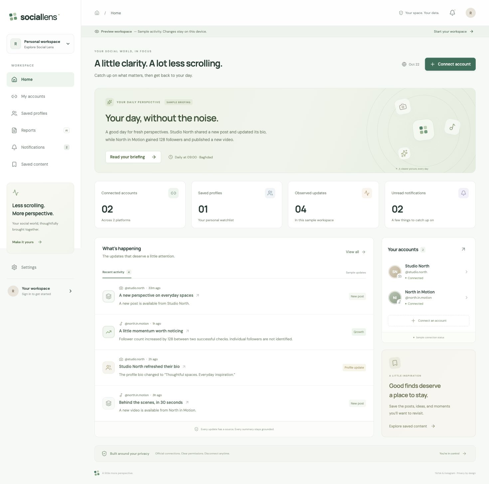

# Social Lens

A quieter way to keep up with TikTok and Instagram. A responsive Next.js app with a polished dashboard, account controls, saved profiles, evidence-backed reports, notifications, bookmarks and privacy preferences.

## Current status

**Working local alpha; live integrations are not activated.** The entire interface can be explored in a labeled preview workspace. Preview changes stay in this browser. Signed-in workspaces use Supabase with row-level security, without sample records.

- Private repository: https://github.com/rozhzero969-hub/social-lens
- New Supabase organization: **Social Lens**, ID `llhwliqrcgxmjylqkqen`.
- The organization creation command succeeded, but the existing CLI and connector authorization cannot create a project in that organization. No live database was provisioned or linked; the browser is signed out. An authenticated owner must authorize the new organization before project creation can finish.
- TikTok and Instagram connections need registered developer apps, credentials, redirect URLs, permissions and platform approval. They do not work until these are supplied.
- AI summaries need an OpenAI API key and model configuration; otherwise reports use a deterministic factual template.
- Email delivery needs Resend configuration. No emails have been sent during implementation.
- Background checks run only after a host and scheduler are configured. GitHub Actions includes the worker schedule, disabled until `APP_URL` is set.
- Public profiles are saved as links. Username monitoring, stories, follower identities, downloads and private activity are not advertised as working.

## Run locally

Requires Node.js 24 and pnpm 11.25.0.

```sh
pnpm install
cp .env.example .env.local
pnpm dev
```

Open http://localhost:3000. Blank environment variables leave the app in preview mode. Do not enter secrets in public variables.

### Interface previews



[Phone layout](docs/screenshots/mobile.png)

```sh
pnpm test        # monitoring, timezone, parsing, encryption and real PostgreSQL RLS tests
pnpm build      # production compilation and TypeScript checks
pnpm start      # serve the production build
```

## Complete Supabase setup

1. Sign in to Supabase and grant the existing integration access to the new **Social Lens** organization, or use an owner-authorized CLI session. The existing `ricotta-orders` project was not modified.
2. Create a project in that organization. Choose a free plan if available; do not accept paid compute without agreeing to its quote.
3. Link the checkout with `supabase link --project-ref YOUR_PROJECT_REF`, inspect tables, and apply `supabase db push`. The checked-in initial migration has been exercised against embedded PostgreSQL. Run Supabase security and performance advisors on the actual project after applying it.
4. Set `NEXT_PUBLIC_SUPABASE_URL`, `NEXT_PUBLIC_SUPABASE_PUBLISHABLE_KEY`, and the server-only `SUPABASE_SECRET_KEY` in `.env.local` and hosting secrets.
5. Set the Supabase Auth site URL to the deployed HTTPS origin. Allow that origin and `/reset-password` as redirect destinations. Keep email confirmation enabled. Set up a production SMTP provider before a public launch.
6. Add GitHub Actions secrets `SUPABASE_ACCESS_TOKEN`, `SUPABASE_DB_PASSWORD`, and repository variable `SUPABASE_PROJECT_ID` to enable the manual database deployment workflow. Restrict the token to this new project.

## Platform setup

See [the capability matrix](docs/platform-capabilities.md) and [deployment instructions](docs/deployment.md). The app never requests a user's social password. The only OAuth scopes are approved profile/video permissions, separately per platform. A first sync creates a baseline without alerting on old posts. Counts never identify individual followers.

## Architecture

- `components/dashboard.tsx`: responsive interactive workspace, seven views, real and preview modes.
- `lib/platforms.ts`: capability gating, username and saved-link validation.
- `lib/monitoring.ts`: snapshot comparison, local report scheduling and quiet hours.
- `lib/adapters.ts`: distinct official TikTok and Instagram OAuth, profile and media adapters.
- `lib/crypto.ts`: authenticated AES-256-GCM token encryption.
- `lib/services.ts`: sync and evidence-grounded reporting.
- `app/api/`: authenticated user actions, OAuth callbacks, health and worker endpoints.
- `supabase/migrations/`: tenant-owned public records; internal credentials, snapshots and job queue in a private schema. Privileged RPCs are denied to browser roles.
- `.github/workflows/`: quality checks, manual database deployments, and an authenticated worker tick every 15 minutes. Individual accounts target hourly checks. GitHub schedules can be delayed; precise delivery times are not guaranteed.

## Production limitations

This is an alpha requiring deployment and live access tests. Provider adapters have not been exercised with real authorized TikTok/Instagram accounts. Verify exact permissions, fields, pagination, refresh, revocation, rate limits, account eligibility and retention obligations during app approval. Current adapters read the latest 20 TikTok videos / 25 Instagram media items per check; high-volume accounts can exceed this window. The initial beta must remain capped until paginated reconciliation and real quotas are tested.

Weekly reports, profile sharing invitations, report chat, push notifications, metric threshold alert rules, collection management, advanced report filters, per-post engagement history, provider deletion webhooks and a dedicated operational dashboard remain follow-up work. The current implementation provides daily reports, follower count changes, content/profile changes within approved scopes, and a basic scheduled worker. Do not call this production-ready or promise uninterrupted monitoring.
